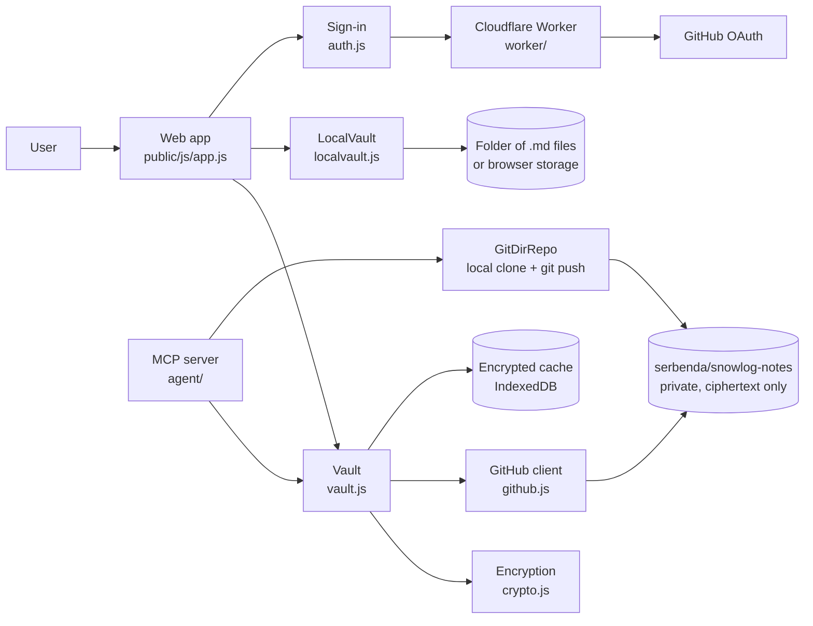

# Architecture

> How it is built, from a bird's-eye view. Update it when a piece or a flow changes, not on every commit.
> The reasons behind each choice are in [decisions/](decisions/).

## Pieces

| Piece | What it does | Technology | Folder |
|---|---|---|---|
| Web app | The interface: tree, editor, reading view, panels, settings, drawings | Plain ES modules, no build | `public/js/app.js`, `public/css/` |
| Encryption | AES-256-GCM with a random data key (DEK) wrapped by the passphrase and by a recovery code (PBKDF2-SHA256) | WebCrypto | `public/js/crypto.js` |
| Vault | Encrypted index + one encrypted file per note or attachment, one commit per save, conflict merging, offline outbox, history, key rotation | — | `public/js/vault.js` |
| GitHub client | REST and GraphQL calls; each save is one atomic commit (Git Data API) | `fetch` | `public/js/github.js` |
| Local vault | The same interface over plain `.md` files in a folder (File System Access), OPFS, or a folder kept in browser storage (`kvdir.js`) | — | `public/js/localvault.js`, `kvdir.js` |
| Markdown | Safe renderer: escapes everything before formatting; frontmatter, tables, callouts, tasks, tags, `[[links]]` | — | `public/js/markdown.js` |
| Index and queries | In-memory index of decrypted notes; Dataview-style `TASK/LIST/TABLE` queries; search; links; graph | — | `noteindex.js`, `query.js`, `search.js`, `links.js`, `graph.js` |
| Drawing engine | Copied from [bsketch](https://github.com/serbenda/bsketch); never edited here | — | `public/js/sketch-*.js`, `public/css/sketch.css`, `public/fonts/` |
| Service worker | Stores the web app itself for offline use; never GitHub or sign-in responses | — | `public/sw.js` |
| Sign-in Worker | Exchanges the GitHub App code for a token; holds the client secret | Cloudflare Workers | `worker/` |
| Portable build | Bundles `public/` into one HTML file with `connect-src 'none'` and hashed script and style | Node script | `scripts/build-portable.mjs` |
| Desktop app | A window that loads `public/` as is, with no commands exposed to the page | Tauri 2 | `desktop/` |
| Agent access | MCP server (JSON-RPC over stdio) and session for scripts, over a local clone of the notes repository | Node, no dependencies | `agent/` (see [AGENT_ACCESS.md](AGENT_ACCESS.md)) |

## Data flow

- **Online:** the passphrase derives a key that unwraps the DEK from `.snowlog/vault.json`; the DEK decrypts the
  index (`.snowlog/index.enc`), and each note (`n/<id>.enc`) or attachment (`a/<id>.enc`) on demand. Writing
  encrypts in the browser and commits through the GitHub API. Every file uses a fresh 12-byte IV and its id as
  additional authenticated data (AAD).
- **Untrusted input:** note text (typed, imported, pasted, from another device or from a backup), attachment
  bytes, `.excalidraw`/`.sketch` files, GitHub API responses and the OAuth redirect. Note text only reaches the
  page through `markdown.js`, `editor.js` or `query.js`, which escape first, and through the Trusted Types policy.
- **On the device:** `vault.json` (wrapped keys only), the GitHub credentials encrypted with the DEK, the encrypted
  cache in IndexedDB, and the web app in the service worker cache. The DEK and decrypted notes live only in
  memory and are wiped on lock.
- **Two devices:** each note remembers the version it was read at. If the index brings another one on save, the
  note is merged line by line (`merge.js`); only clashing lines keep the other version as a copy. Drawings merge
  element by element.
- **Offline:** a failed commit (`TypeError`) puts the vault in offline mode; saves wait encrypted in the outbox and
  `sync()` uploads them as normal saves when the network is back.
- **Portable and local:** notes are plain `.md` files (not encrypted, protected by the computer account); the
  portable CSP forbids every connection.

### Two versions

| | Online | Portable |
| --- | --- | --- |
| File | `public/` on GitHub Pages | `snowlog-portable.html` (built by `scripts/build-portable.mjs`) |
| Vault | `Vault` (`vault.js`): GitHub, encrypted | `LocalVault` (`localvault.js`): `.md` in a folder, in OPFS or in browser storage |
| Network | The GitHub API and the Worker | None (`connect-src 'none'`) |
| `CONFIG.mode` | `online` | `portable` |

`LocalVault` has the same interface as `Vault`, so the interface does not tell them apart (`S.local` only
changes the start, closing or forgetting, and export).

### Repositories

| Repository | Visibility | Content |
| --- | --- | --- |
| `serbenda/snowlog` | public | the app's code, Worker, tests, docs |
| `serbenda/snowlog-notes` | private | `.snowlog/vault.json`, `.snowlog/index.enc`, `.snowlog/keyring.enc`, `n/<id>.enc`, `a/<id>.enc` |

They are kept apart on purpose: the app's token can only write to the notes, so even if stolen it cannot change
the code of the site.

## External sources
| Source | What it provides | License | If it fails… |
|---|---|---|---|
| GitHub REST and GraphQL APIs | Storage, history and sync of the encrypted notes | GitHub terms | Offline mode: reading cached notes and queueing saves; GraphQL falls back to REST |
| GitHub App + Cloudflare Worker | Sign-in with GitHub | GitHub and Cloudflare terms | A personal access token still works |
| [bsketch](https://github.com/serbenda/bsketch) | The drawing engine, copied by `scripts/update-sketch.mjs` | The owner's own code | Drawings keep working with the copied version |
| Caveat font (in `public/fonts/`) | Handwriting in drawings | SIL Open Font License 1.1 (`public/fonts/OFL.txt`) | The system cursive is used (as in the portable build) |

## Code conventions
- Plain modern JavaScript, small functions, no frameworks and no runtime dependencies (no npm at runtime).
- Every module that the portable build bundles uses only `import { … } from './x.js'` or
  `import * as X from './x.js'`, and `export function|const|class`.
- Never `innerHTML` with note text except through `markdown.js` (or `editor.js`/`query.js`, which escape first);
  every `innerHTML` goes through `trusted()` (the `snowlog` Trusted Types policy).
- Links in notes only allow `http(s)`, `mailto` and anchors.
- Any new file type in the notes repository is encrypted with its id as AAD; no plaintext ever.
- The key and the passphrase live only in memory: never in `localStorage`, logs or error messages.
- Changes to `crypto.js`, `vault.js`, `localvault.js` or `markdown.js` come with new tests.
- `public/js/sketch-*.js`, `public/css/sketch.css` and `public/fonts/` are copies from sketch: change them there and
  run `node scripts/update-sketch.mjs <path-to-sketch>`.
- Interface texts, code and docs in English. Note content, folder names and queries written by the user are data:
  the defaults are English, and vaults with the earlier Spanish folder names keep them (`LEGACY_WORKSPACE` in
  `templates.js`).
- If the Worker URL changes, change it in `config.js` and in the CSP of `index.html` too (a test checks it).
