# Workflows

Every way of using this template, as diagrams. Start with the first one: it sends you to the right flow for
what you want to do. GitHub renders the diagrams; in an editor, use a Mermaid preview.

- [1. What do you want to do?](#1-what-do-you-want-to-do)
- [2. Start a new project](#2-start-a-new-project)
- [3. Light or full mode](#3-light-or-full-mode)
- [4. A working session with Claude](#4-a-working-session-with-claude)
- [5. A phase, in full mode](#5-a-phase-in-full-mode)
- [6. A piece of work, in light mode](#6-a-piece-of-work-in-light-mode)
- [7. A hard-to-undo decision](#7-a-hard-to-undo-decision)
- [8. From a change to `main`](#8-from-a-change-to-main)
- [9. Security: where each check runs](#9-security-where-each-check-runs)
- [10. When something is blocked](#10-when-something-is-blocked)
- [11. Before a release](#11-before-a-release)
- [12. Bring an existing project up to date](#12-bring-an-existing-project-up-to-date)
- [13. Update a third-party skill](#13-update-a-third-party-skill)

## 1. What do you want to do?

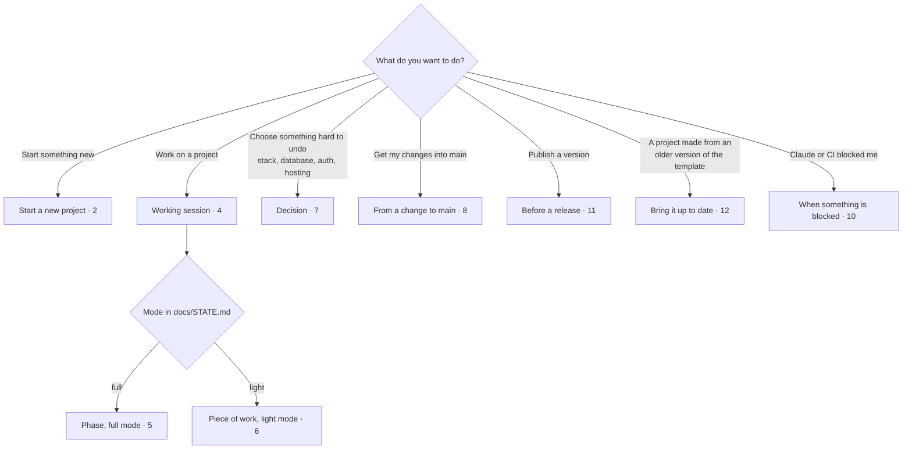

## 2. Start a new project

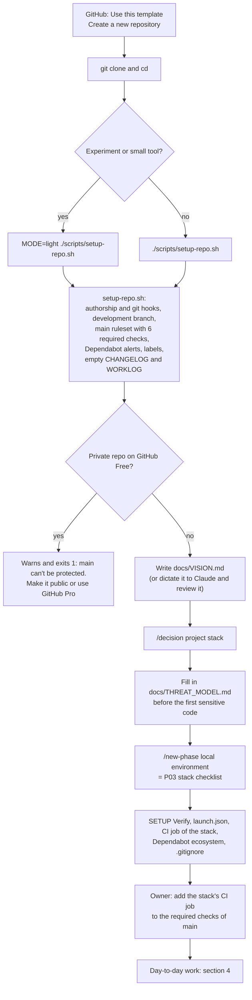

## 3. Light or full mode

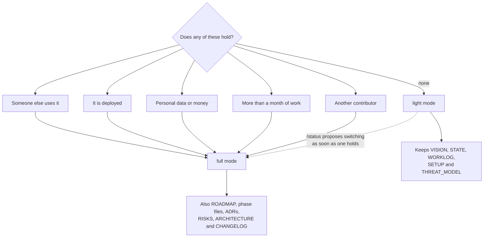

## 4. A working session with Claude

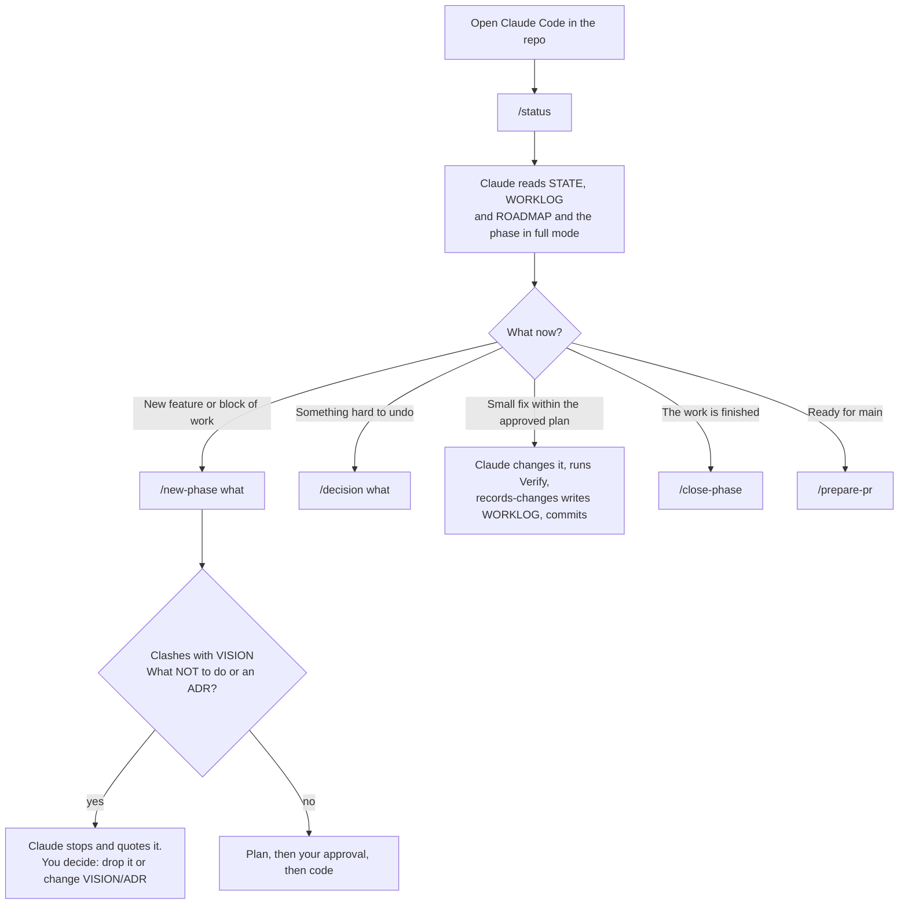

## 5. A phase, in full mode

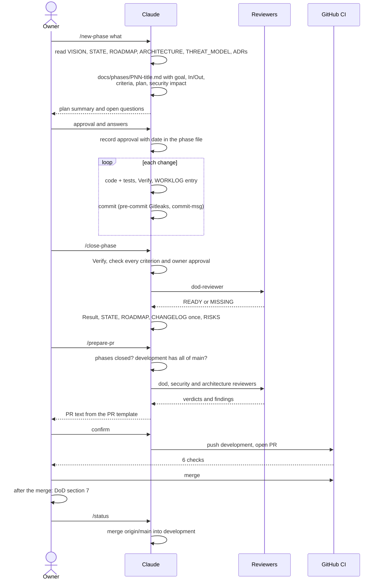

## 6. A piece of work, in light mode

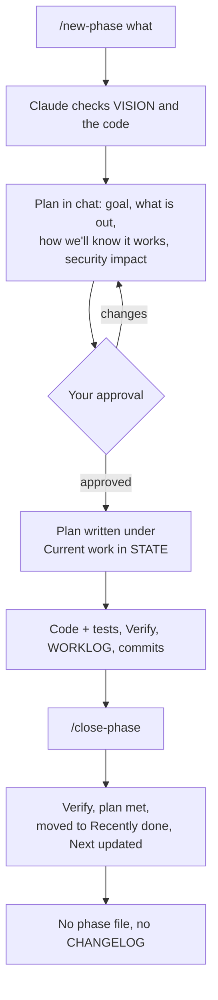

## 7. A hard-to-undo decision

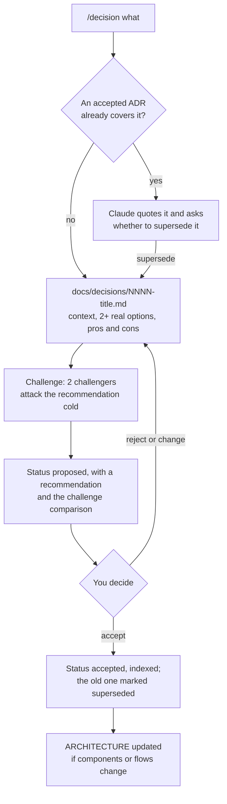

## 8. From a change to `main`

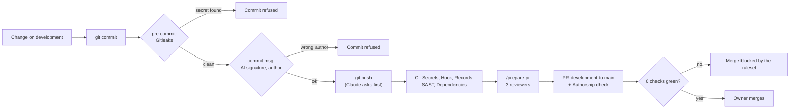

## 9. Security: where each check runs

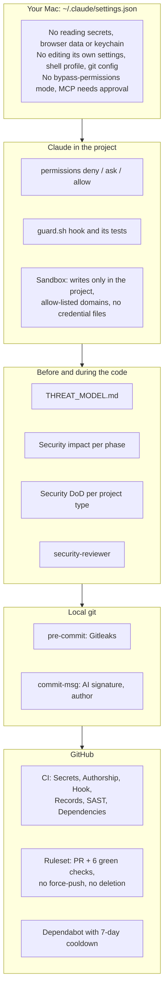

## 10. When something is blocked

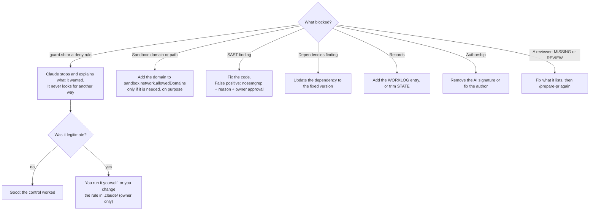

## 11. Before a release

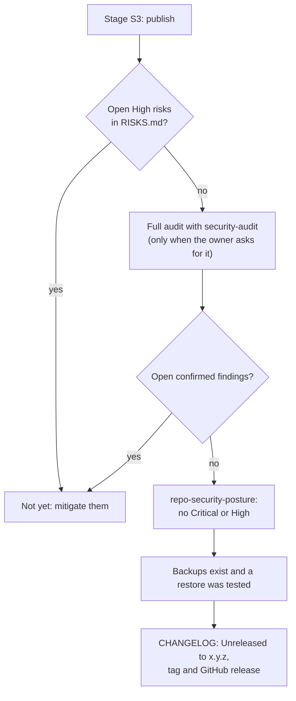

## 12. Bring an existing project up to date

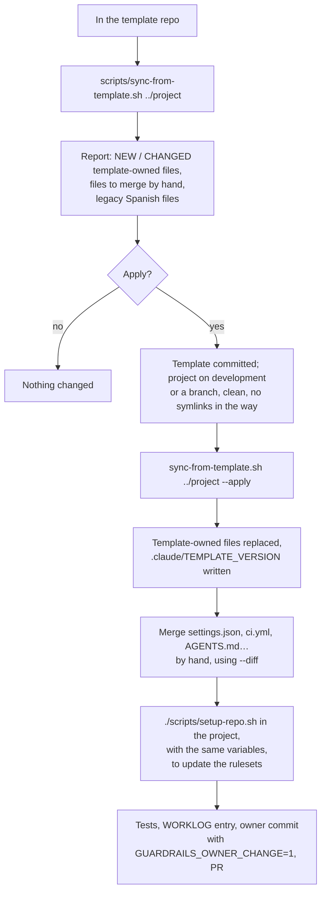

## 13. Update a third-party skill

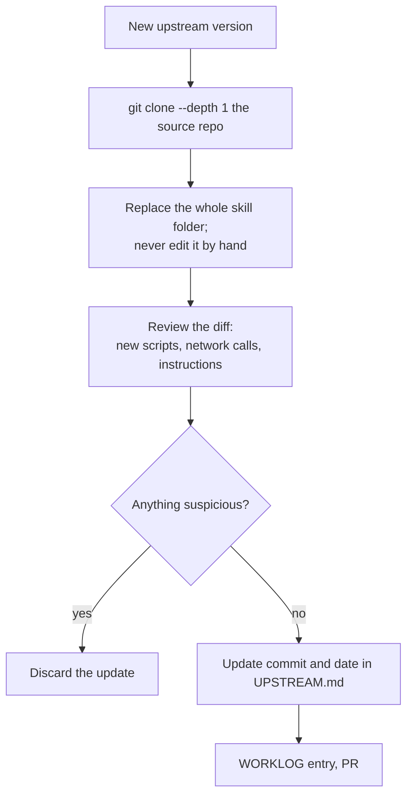
